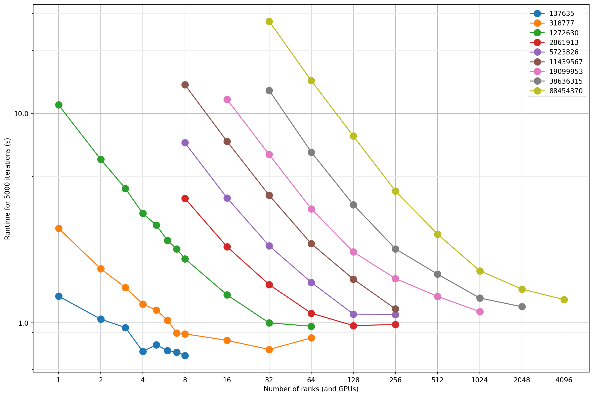

# How to run the code

The CPU version of the code is built to support hybrid parallelism, that is it uses MPI to distribute work between different ranks and then OpenMP to further parallelize the code within a rank. In case you can you should use SIMD as well, using the widest vectors your system supports.

For small simulations on few nodes, using SMT may be beneficial, but it seems it does have an impact on the communication performance on larger runs.

The measured runtime breakdown the code prints out can be used to check the performance of the code. The code will output this after 100,200,1000,2000,5000 iterations, and after that every 5000th iteration.
The time reported is based on the previous interval, so the first time is for the first 100 iterations, the second for the 100 iterations after that, the third for 800 iterations and so on.

The runtime printed is structured as follows (still subject to change):

First the timestep that was completed is printed, secondly and thirdly how many links and neighbours were iterated over, this can be useful to see how much the particles have spread out and how many links are breaking. 
Fewer iterated links and neighbors should increase the performance observed as that just means less compute for each particle.

Then there is a table of runtimes for different parts that gets printed, the first column is the hierarchical level of the measurement, the second column is the name. 
The first colum works such that events that happen inside of another event gets put one level deeper, the levels are indicated by the number of `-` characters. 
As an example

```text
           grid service                   
-          dist limit reduce              
--         accumilate dist                
---        get max dist owned                                 
```

Would have the `grid service` event, and then under it there is a `dist limit reduce` event and so on, the time reported for `grid service` also encompasses the times for the events under it.

The times reported for average, min and max are based on the accumulated time for that interval, so for the first 100 iterations it will just be for 100, but once the code gets to outputting the timing every 5000 iterations it will all be for the previous 5000 iterations.
The last columns minMin and maxMax, is the min and max for a single event for the previous interval.

# Reference performance

// Todo fill in later

## Inputs

The performance data here is all collected using the `MeshBlock` sample code, and the input in that directory.

// insert picture of what the wedge looks like


## Systems

For this comparison the following systems were used:

| Name         | CPU           | Cores per node | Network    | GPU                               |
|--------------|---------------|----------------|------------|-----------------------------------|
| Mahti        | 2x AMD 7H12   | 128            | 200 Gbit   | N/A                               |
| Mahti-G      | 2x AMD 7H12   | 128            | 2x200 Gbit | 4x Nvidia A100 (40GB)             |
| Lumi-C       | 2x AMD 7763   | 128            | 200 Gbit   | N/A                               |
| Lumi-G       | 1x AMD XXXX   | 64             | 4x200 Gbit | 4x AMD MI250X (8 GCDs)            |
| Puhti        | 2x Intel 6230 | 40             | 1x100 Gbit |                                   |
| FR Desktop 1 | 1x AMD 7950x  | 16             | N/A        | RTX 3050 \| RTX 2080Ti \| RTX5090 |
| FR Laptop    | 1x AMD 7940hs | 8              | N/A        | RTX 4060 Mobile                   |


## Single compute unit comparison

The point of this table is to compare different systems, what one GPU or one CPU node is able to achieve.
For testing two different sized runs were used, the 310k particle one and the 5700k particle one, both were run with the default scale set by those samples.
The timing is taken from 25 to 30k time steps. // add tool to run both these and extract performance
Memory bandwidth is based on BabelStream, taking the triad result (without any optimization for non temporal stores)

| Device       | Sample | 5k iteration time | Notes      | Version | Stream BW   | FP32/64 peak |
|--------------|--------|-------------------|------------|---------|-------------|--------------|
| RTX5090      | 310k   | 2.16 sec          |            | V0.14   | 1573 GB/s   |              |
|              | 5700k  | 25.83 sec         |            | V0.14   |             |              |
| RTX2080Ti    | 310k   | 4.19 sec          |            | V0.13.1 | 555 GB/s    |              |
|              | 5700k  | 60.55 sec         |            | V0.13.1 |             |              |
| MI250X       | 310k   | 2.376 sec         | Single GCD | V0.14   | 1247 GB/s   |              |
|              | 5700k  | 36.26 sec         | Single GCD | V0.14   |             |              |
| MI250X       | 310k   | 1.623 sec         | Both GCDs  | V0.14   | 1247x2 GB/s |              |
|              | 5700k  | 21.03 sec         | Both GCDs  | V0.14   |             |              |
| RTX3050      | 310k   | 11.76 sec         |            | V0.13.1 | 210 GB/s    |              |
|              | 5700k  | 177 sec           |            | V0.13.1 |             |              |
| RTX4060      | 310k   | 8.885 sec         | ~100W cap  | V0.13.1 | 229 GB/s    |              |
|              | 5700k  | N/A               |            | V0.13.1 |             |              |
| A100         | 310k   | 2.402 sec         |            | V0.13.1 | 1374 GB/s   |              |
|              | 5700k  | 33.75 sec         |            | V0.13.1 |             |              |
| 2x AMD 7763  | 310k   | 6.299 sec         |            | V0.13.1 | 228 GB/s    |              |
|              | 5700k  | 134.4 sec         |            | V0.13.1 |             |              |
| 1x AMD 7950x | 310k   | 29.42 sec         |            | V0.14   | 63 GB/s     |              |
|              | 5700k  | ~650 sec          |            | V0.14   |             |              |

## OpenMP scaling

These tests were carried out on Lumi-C, so a node with 2x64 core CPUs. 
The code always uses all 128 cores, so running at least 128 threads SMT usage in indicated for the results using it.

| MPI | OMP | Tot threads | Time 310k  | Time 5700k | Time 310k 2 Nodes |
|-----|-----|-------------|------------|------------|-------------------|
| 1   | 128 | 128         | 10.16s     | 169.1s     | 7.86s             |
| 2   | 64  | 128         | 8.098s     | 164.2s     | 4.746s            |
| 4   | 32  | 128         | 7.387s     | 162.8s     | 4.244s            |
| 8   | 16  | 128         | 7.012s     | 143.3s     | 3.894s            |
| 16  | 8   | 128         | **6.459s** | **134.4s** | **3.546s**        |
| 32  | 4   | 128         | 6.483s     | 136.3s     | 3.922s            |
| 64  | 2   | 128         | 6.775s     | 139s       | 4.022s            |
| 128 | 1   | 128         | 7.362s     | 145.7s     | N/A               |
| 1   | 256 | 256         | 10.04s     |            | 8.969s            |
| 2   | 128 | 256         | 7.817s     |            | 4.698s            |
| 4   | 64  | 256         | 7.319s     |            | 4.111s            |
| 8   | 32  | 256         | 7.016s     |            | 3.847s            |
| 16  | 16  | 256         | 6.418s     |            | **3.626s**        |
| 32  | 8   | 256         | **6.299s** |            | 4.114s            |
| 64  | 4   | 256         | 6.671s     |            | 4.252s            |
| 128 | 2   | 256         | 7.391s     |            | N/A               |

There is some gains to be had by choosing the right combination of OpenMP threads and MPI ranks to use.
On LUMI-C the most optimal configuration is likely 16 MPI ranks and 8 OpenMP threads per node.

The use of SMT, i.e. using 2 threads per core is questionable if the performance is worth it, 
on a single node there is a minute performance uplift, but when using more than one node using SMT is slower. 

## AVX2/512 Performance

Comparing basic scalar and AVX2 on LUMI, so testing with building the code without and SIMD flags and with `-DENABLE_SIMD256=1` yields the following results:
These tests were carried out using 2 nodes with 16 MPI ranks per node and 8 OpenMP threads per rank and not using SMT.

|        | Time 310k  | Time 5700k |
|--------|------------|------------|
| Scalar | 4.14s      | 77.28s     |
| AVX2   | 3.594s     | 63.64s     |

The two Intel 6230 CPUs in a Puhti node do support AVX512 but it is not the ideal implementation, and clocks down quite aggressively when used. 
And while the desktop AMD 7950x does support AVX512 it does so by doing the operations as two 512 bit operations so it is also not an ideal platform.
Keep that in mind with following numbers on AVX512 performance compared to AVX2 and scalar, a good full 512 bit architecture would likely perform even better.

**2x Intel 6230**

Single node 4 ranks 10 threads each.

|        | Time 160k  | Time 310k |
|--------|------------|-----------|
| Scalar | 14.69s     | 38.86s    |
| AVX2   | 12.45s     | 32.1s     |
| AVX512 | 10.94s     | 27.94s    |

**AMD 7950x**

Single rank 16 threads.

|        | Time 160k | Time 310k  |
|--------|-----------|------------|
| Scalar | 14.3s     | 38.64s     |
| AVX2   | 13.01s    | 33.06s     |
| AVX512 | 9.6s      | 28.14s     |

It should be noted however that the SIMD code paths are far less tested, so in case any issues arise disable the SIMD flags and see if the problem is resolved.

## Multi node scaling

These tests were carried out at the very beginning of the simulation, measuring timesteps between 25k and 30k iterations. 
This does not include two potential time wasting functions, IO and rebalacning. 
IO should scale based on the amount of particle and link data being written, and the compression level applied.
The perforamnce of the redistribution step is however not ideal, the time taken by it scales with the number of ranks used, and sadly has a exponential looking curve to it. This is expected to improve in later version with a better solution to genrating balanced domains.

The graph below shows scalability for different cases on LUMI running on the GPU partition, each node has effectively 8 GPUs, as each of the MI250x GPUs show up as two, so a full node runs 8 ranks. The number of particles used by each case is shown in the figure legend.



## Performance stability

Todo: still missing

